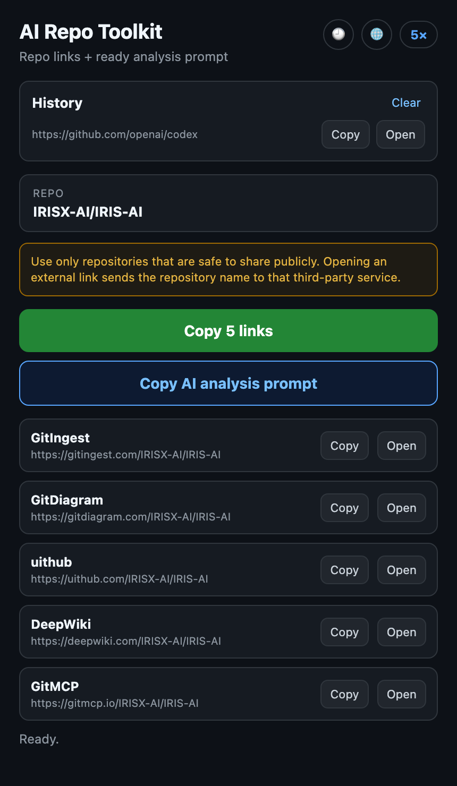

# GitHub AI Repo Toolkit

<p align="center">
  
</p>

[](https://github.com/gencaykut/github-ai-repo-toolkit/actions/workflows/ci.yml)
[](LICENSE)
[](manifest.json)

A lightweight Chrome extension that turns the GitHub repository in your active
tab into a set of AI-friendly links and a ready-to-use technical analysis
prompt.

The extension does **not** analyze repositories itself, upload repository
contents, or call an AI model. Link generation and prompt creation happen
locally in the popup.



## Features

- Generates repository links for GitIngest, GitDiagram, uithub, DeepWiki, and GitMCP.
- Copies all generated links at once or one at a time.
- Creates a localized technical-analysis prompt with all generated sources.
- Supports Turkish, English, German, Spanish, and French.
- Keeps a local, deduplicated history of the last 10 copied repository URLs.
- Lets users copy, open, or clear repository history from the popup.
- Includes keyboard navigation, focus indicators, and screen-reader status updates.

## Installation

1. Download or clone this repository.
2. Open `chrome://extensions` in Chrome.
3. Enable **Developer mode**.
4. Select **Load unpacked**.
5. Choose this repository's directory.

Open a public GitHub repository and select the extension from the Chrome toolbar.

## Example

For `https://github.com/IRISX-AI/IRIS-AI`, the extension generates:

- `https://gitingest.com/IRISX-AI/IRIS-AI`
- `https://gitdiagram.com/IRISX-AI/IRIS-AI`
- `https://uithub.com/IRISX-AI/IRIS-AI`
- `https://deepwiki.com/IRISX-AI/IRIS-AI`
- `https://gitmcp.io/IRISX-AI/IRIS-AI`

## Permissions and privacy

| Permission       | Why it is needed                                     |
| ---------------- | ---------------------------------------------------- |
| `activeTab`      | Read the URL of the GitHub tab when the popup opens. |
| `clipboardWrite` | Copy generated links and prompts to the clipboard.   |
| `storage`        | Save language preference and repository URL history. |

The extension does not run in the background and does not collect analytics,
credentials, repository contents, or general browsing history. It contacts no
external service on its own. When you choose **Open** for a generated link, your
browser navigates to that third-party service and its own privacy terms apply.

Copying a generated service link, the complete link list, or the analysis prompt
stores only that repository's canonical GitHub URL in local extension storage.
The history is limited to 10 unique URLs and can be cleared from the popup.

Use the extension only with repositories whose names are safe to disclose.
Opening a generated link shares the repository owner and name with the selected
third-party service. The popup displays this warning before the service links.

GitIngest, GitDiagram, uithub, DeepWiki, GitMCP, GitHub, and Chrome are
third-party products or trademarks. This project is not affiliated with or
endorsed by their owners.

## Development

Node.js 20 or later is required for development checks only. The extension has
no runtime npm dependencies.

```bash
npm install
npm test
npm run check
npm run format:check
npm run package
```

The package command creates a release-ready ZIP in `dist/` containing only the
runtime extension files.

See [CONTRIBUTING.md](CONTRIBUTING.md) for contribution guidelines and
[SECURITY.md](SECURITY.md) for responsible vulnerability reporting. Before a
release, follow [MANUAL_TESTING.md](MANUAL_TESTING.md).

## Known limitations

- Only `github.com` and `www.github.com` repository URLs are supported. GitHub Enterprise hosts are not supported.
- The extension generates URLs but does not verify whether a repository or third-party service page exists.
- Availability and behavior of third-party services can change independently of this project.
- Repository history is local to the current Chrome profile and is not synced by the extension.

## License

Released under the [MIT License](LICENSE).
